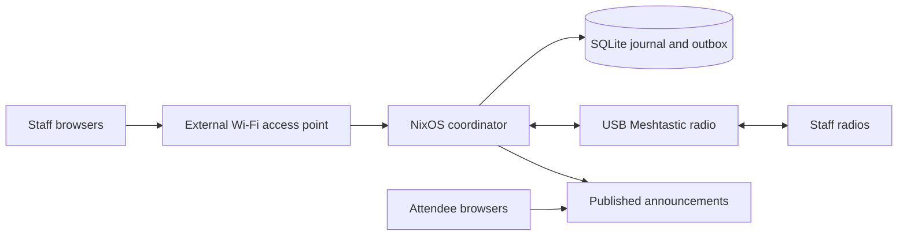

# Mish

**Local coordination for events that need to run offline.**

Mish gives event staff a private place to exchange short messages, raise
operational alerts and acknowledge who is responding. Attendees get a separate,
read-only feed of announcements the operator chooses to publish. You run the
coordinator, enroll your staff and keep event data on your own appliance.

An external Wi-Fi access point connects staff browsers to a NixOS coordinator
over the local network. A USB Meshtastic radio connects it to staff radios.
Event operation requires no cloud account, hosted service or internet connection.

## What staff and operators can do

- **Coordinate privately.** Exchange staff text in the browser and through the
  radio adapter, with a local SQLite journal and durable outbound queue.
- **Make responsibility visible.** Give alerts a responder and expiry, then
  collect explicit acknowledgements from enrolled staff or radio replies.
- **Publish deliberately.** Share official announcement text with attendees
  while keeping staff conversations, identities and unpublished alerts private.
- **Recover with context.** Back up event history and credentials, restore to a
  spare, and review uncertain sends before creating replacements.

Mish keeps local persistence, radio submission, transport confirmation and
human acknowledgement separate. A radio confirmation does not mean a person
read an alert. Staff can reply `ACK <ID>` from stock radio clients; those replies
retain their radio node and channel provenance.

## One coordinator, a local network and staff radios



The first deployment target is an x86_64 mini-PC, followed by Raspberry Pi 4
with 4 GB RAM. One coordinator is authoritative; a spare is activated manually.
Staff devices trust the event's local HTTPS certificate authority during setup.
Operator tokens and private radio channel keys are provisioned for the event
and are absent from shared images.

## Start here

**Preparing an event:** follow [commissioning and recovery](docs/commissioning.md)
to install the appliance, configure your AP and private radio channel, enroll
staff and send the first message. Keep the
[operator runbook](docs/operator-runbook.md) available during the event.

**Evaluating or contributing:** use the build commands below, then read the
[architecture and milestone gates](docs/roadmap.md),
[HTTP API](docs/api.md) and [contribution guide](docs/contributing.md).

**Checking readiness:** consult the revision-specific
[verification evidence](docs/verification.md) and complete the
[physical acceptance record](docs/acceptance.md) on your hardware.

## Build and verify

```bash
nix develop --command nix flake check --no-build --all-systems
nix develop --command nix flake check
nix develop --command nix build .#packages.x86_64-linux.mish-mini-pc-image
nix develop --command nix build .#packages.x86_64-linux.mish-mini-pc-installer
nix develop --command nix build .#packages.aarch64-linux.mish-rpi4-image
```

The x86 image is a QEMU appliance; the installer is a separate ISO. The Pi 4
output is an SD image and requires a native ARM builder. NixOS 26.05 and the
committed `flake.lock` define the supported appliance build. See the
[building guide](docs/building-alpha.md) for builder setup and evidence levels.

The CLI is `mish`, the NixOS module is `services.mish`, and runtime state
defaults to `/var/lib/mish`. Filesystem access to that state is administrative
access. The bundled browser app uses a local SQLite journal; Caddy provides
local HTTPS.

## Readiness and scope

Native x86 and ARM checks, image realization and booted x86 VM application tests
have passed for the revisions recorded in the
[verification log](docs/verification.md). Physical installation, USB/RF
interoperability, Pi 4 commissioning and an eight-hour event rehearsal remain
unverified. This is a prototype for qualification, with draft releases gated
on physical acceptance.

The first release focuses on staff coordination and explicit public
announcements. Matrix and OpenZiti are optional health stubs, Reticulum has no
application messaging bridge, and waypoint/GeoPack simulations and mock/file
Nostr publication are development facilities. Those integrations and additional
hardware profiles remain deferred; the
[design history](docs/mish-design-history.md) explains the narrower direction.
