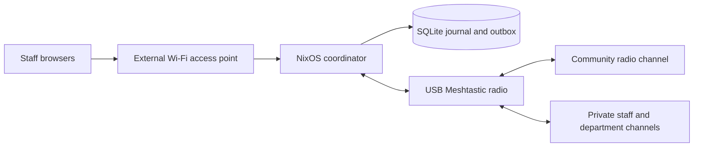

# Mish

**Local coordination for events that need to run offline.**

Mish brings local event coordination and Meshtastic radio communication into
one owner-operated appliance. Staff exchange short messages, raise operational
alerts and acknowledge who is responding. The channel-enrollment design adds a
shared community mesh alongside private staff and department channels. You run
the coordinator, choose who joins each private group and keep event data local.

An external Wi-Fi access point connects staff browsers to a NixOS coordinator
over the local network. A USB Meshtastic radio connects it to staff radios.
Event operation requires no cloud account, hosted service or internet connection.

## What staff and operators can do

- **Coordinate privately.** Exchange staff text in the browser and through the
  radio adapter, with a local SQLite journal and durable outbound queue.
- **Make responsibility visible.** Give alerts a responder and expiry, then
  collect explicit acknowledgements from enrolled staff or radio replies.
- **Bring people onto the mesh.** The new enrollment design supports an existing
  channel or an event mesh such as Astral Valley's `AstralMesh`, with a public
  join QR and separate private staff or department QRs.
- **Recover with context.** Back up event history and credentials, restore to a
  spare, and review uncertain sends before creating replacements.

Mish keeps local persistence, radio submission, transport confirmation and
human acknowledgement separate. A radio confirmation does not mean a person
read an alert. Staff can reply `ACK <ID>` from stock radio clients; those replies
retain their radio node and channel provenance.

## Community participation, private coordination

Channel enrollment is implemented with scoped software tests. Physical
provisioning evidence is still required before it is declared event-ready.
The design uses one community primary channel and private secondary channels,
with a maximum of eight radio channels in total.

A public Meshtastic QR intentionally shares the community channel key and
allows people to transmit on that channel. Staff and department keys stay in
separate, access-controlled enrollment artifacts. Radio enrollment and a Mish
web identity are separate: copying a radio key grants channel access, and
revoking a web token does not revoke that copied key.

The design supports importing an existing mesh while preserving its LoRa
settings, or generating an event configuration with full 256-bit keys. An
operator explicitly provisions the USB radio and verifies readback; reconnect
alone must not overwrite a radio's configuration. See the
[channel enrollment design](docs/channel-enrollment.md) for group membership,
QR scope, key rotation and acceptance gates. Community participation uses the
Meshtastic app; the public browser provides enrollment QR codes. Public radio
access does not grant staff browser access.

## One coordinator, a local network and staff radios



The first deployment target is an x86_64 mini-PC, followed by Raspberry Pi 4
with 4 GB RAM. One coordinator is authoritative; a spare is activated manually.
Staff devices trust the event's local HTTPS certificate authority during setup.
Operator tokens and private radio channel keys are provisioned for the event
and are absent from shared images.

## Start here

**Preparing an event:** follow [commissioning and recovery](docs/commissioning.md)
to install the appliance and configure your AP. Review
[channel enrollment](docs/channel-enrollment.md) for the community/staff design
and its provisioning gates, then enroll staff and send the first message. Keep the
[operator runbook](docs/operator-runbook.md) available during the event.

**Evaluating or contributing:** use the build commands below, then read the
[architecture and milestone gates](docs/roadmap.md),
[Den composition](docs/den-architecture.md),
[HTTP API](docs/api.md) and [contribution guide](docs/contributing.md).

**Checking readiness:** start with the [product status](docs/product-status.md), consult the revision-specific
[verification evidence](docs/verification.md) and complete the
[physical acceptance record](docs/acceptance.md) on your hardware.

## Build and verify

Den aspects compose the appliance's modes, features and architecture profiles.
The [composition guide](docs/den-architecture.md) explains where to add a feature
or select a mode while keeping the existing package and image targets.
Use the bounded launcher in the [contribution guide](docs/contributing.md) for
local checks; full all-system, VM and image qualification runs on GitHub.

```bash
nix develop --command nix flake check --no-build --all-systems
nix develop --command nix flake check
nix develop --command nix build .#packages.x86_64-linux.mish-mini-pc-image
nix develop --command nix build .#packages.x86_64-linux.mish-mini-pc-installer
nix develop --command nix build .#packages.aarch64-linux.mish-rpi4-image
```

The x86 image is a QEMU appliance; the installer is a separate ISO. The Pi 4
output is an SD image and requires a native ARM builder. NixOS 26.05 and the
committed `flake.lock` define the supported appliance build. See the
[building guide](docs/building-alpha.md) for builder setup and evidence levels.

The CLI is `mish`, the NixOS module is `services.mish`, and runtime state
defaults to `/var/lib/mish`. Filesystem access to that state is administrative
access. The Rust service uses Axum for HTTP, Clap for the CLI and a bounded
Tokio coordinator connected to a dedicated SQLite storage thread. Browser
assets ship with the binary, and native serial I/O handles the Meshtastic
adapter. Caddy provides local HTTPS. See the
[Rust architecture decision](docs/rust-architecture.md) for the typed domain and
delivery-state boundaries.

## Readiness and scope

Native x86 and ARM checks, image realization and booted x86 VM application tests
passed for the earlier revisions recorded in the
[verification log](docs/verification.md). The enrollment suite has 68 passing
Rust tests and seven browser channel-selection tests under the bounded local
development shell, with strict Clippy and formatting checks. Native GitHub
and image results are recorded per revision. Physical installation, USB/RF
interoperability, Pi 4 commissioning and an eight-hour event rehearsal remain
unverified. This is a prototype for qualification, with draft releases gated
on physical acceptance.

The first release focuses on local mesh participation and private staff
coordination. Channel generation, scoped QR enrollment and verified USB
provisioning have their own behavioral tests and acceptance gates; earlier
application checks do not establish physical interoperability. Matrix and OpenZiti are optional health stubs, Reticulum has no
application messaging bridge, and waypoint/GeoPack simulations and mock/file
Nostr publication are development facilities. Those integrations and additional
hardware profiles remain deferred; the
[design history](docs/mish-design-history.md) explains the narrower direction.
