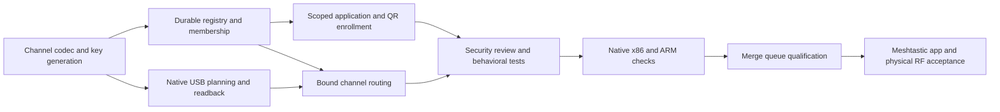

# Channel enrollment design

Mish should join an existing Meshtastic community channel or prepare a named
event mesh. For example, an Astral Valley event can offer `AstralMesh` as its
community channel, with separate private staff and department channels.

The Rust implementation includes the CLI/API contracts below, scoped QR
exports and simulated USB provisioning tests. Software results are recorded
against the tested revision in [verification.md](verification.md). Physical radio provisioning
remains unverified.

## Choose the event's channel set

Import a single PRIMARY community URI when joining an established mesh. Preserve
its LoRa settings and opaque unknown fields so importing and exporting do not
silently change modem behavior or discard settings Mish does not interpret.
Channel editing and deployment are deliberate operator actions.

For a new event mesh, use a community primary channel and private secondary
channels. Radios support at most eight channels in total. Channel names are
limited to 11 UTF-8 bytes; validate bytes rather than assuming eleven Unicode
characters fit. A longer event name and its shorter radio channel label can
remain distinct.

Generate a full 256-bit community PSK and an independent, random 32-byte key
for every private staff or department channel. Keep those keys in protected
runtime state. Shared appliance images and the Nix store contain no event
channel secrets.

## Enroll community, staff and departments

| Enrollment | Intended recipient | Included channel configuration |
|---|---|---|
| Public community QR | Anyone invited to join the event mesh | Community primary only |
| Private staff QR | Staff with explicit access to the staff channel | Community plus authorized staff channel |
| Private department QR | Staff assigned to the selected department | Community plus that selected department |

Generate Meshtastic-compatible enrollment links and QR artifacts locally in
the Rust application. A public QR intentionally discloses the community key
and permits its recipients to transmit. This is a shared communication channel.

Private QR generation requires authorization and explicit group membership.
A department's enrollment artifact must not include another department's key or
an unrequested staff key. Public endpoints, public previews and community QR
artifacts must contain no private channel settings, keys or staff identities.

Web identities and radio credentials are separate. A staff browser token
authorizes Mish application operations; a Meshtastic key authorizes channel
access on radios. Radio enrollment does not create a browser identity, and
revoking a browser token cannot revoke a key copied to a radio or screenshot.
Remove that access by rotating the affected channel key and re-enrolling the
remaining authorized radios. Treat private QR files and printed copies as
private channel credentials.

## Provision the USB radio explicitly

Inspect the connected device and intended channel/LoRa configuration before
writing. Use a stable `/dev/serial/by-id` path. Provisioning is an explicit
operator command, independent of the reconnecting message adapter.

After writing, read the configuration back from the device and compare the
intended settings. Report success only after verified readback. A disconnect,
timeout or differing readback leaves provisioning incomplete; inspect the
device before retrying. Connection or adapter restart must not automatically
overwrite an existing radio's channels or LoRa settings.

The messaging adapter verifies keys, slots and LoRa settings when it connects
and disconnects when the radio reports a configuration change. It cannot
continuously detect an unreported edit through another client. Stop
`mish-control` before changing the radio in the Meshtastic app or another
client, then deploy and verify the stored plan before restarting the service.

## Operator CLI workflow

The following examples use the selected CLI contract. Stop `mish-control`
before any command accesses the USB device; the service and provisioning CLI
must not compete for the serial port. Run state operations as the `mish` user.
Create protected, service-owned output directories in advance.

```bash
sudo systemctl stop mish-control
sudo install -d -m 0700 -o mish -g mish /var/lib/mish/enrollment
sudo -u mish mish --config /etc/mish/config.json channels create \
  --region 'Astral Valley' --name AstralMesh --staff-name Staff \
  --department Medical --department Safety \
  --device /dev/serial/by-id/REPLACE-WITH-THE-RADIO
sudo -u mish mish --config /etc/mish/config.json channels list
```

`create` inspects the radio and stores an unverified plan; it does not deploy
that plan. To join an existing community instead, import a protected file
containing its single PRIMARY enrollment URI:

```bash
sudo -u mish mish --config /etc/mish/config.json channels join \
  --input /protected/community-url.txt \
  --device /dev/serial/by-id/REPLACE-WITH-THE-RADIO
```

`join` also inspects the device and stores an unverified plan. Multi-channel
imports are rejected at this community-import boundary; do not distribute a
private channel set as a community join link. Preserve the imported LoRa
configuration and unknown fields when constructing the plan.

Review the layout before explicit deployment. The recovery output captures the
radio's prior configuration and must be kept private:

```bash
sudo -u mish mish --config /etc/mish/config.json channels deploy \
  --device /dev/serial/by-id/REPLACE-WITH-THE-RADIO \
  --recovery /var/lib/mish/enrollment/radio-before.json
sudo -u mish mish --config /etc/mish/config.json channels list
```

Deployment writes configuration and verifies readback before marking the plan
verified. Export requires a verified configuration and its LoRa snapshot.
Examples for public community and private Medical department QR artifacts:

```bash
sudo -u mish mish --config /etc/mish/config.json channels export \
  --id community --output /var/lib/mish/enrollment/community.svg
sudo -u mish mish --config /etc/mish/config.json channels export \
  --id department-medical --output /var/lib/mish/enrollment/medical.svg
sudo systemctl start mish-control
```

Exports and recovery files use mode `0600`. The CLI writes QR artifacts to the
chosen file and does not dump private enrollment URLs to the console. Only the
community artifact is suitable for public distribution. The department artifact
contains community plus Medical, without staff or other departments.

Assign web-channel membership explicitly after staff enrollment:

```bash
sudo -u mish mish --config /etc/mish/config.json channels grant \
  --staff-id REPLACE-WITH-STAFF-ID --channel department-medical
sudo -u mish mish --config /etc/mish/config.json channels revoke \
  --staff-id REPLACE-WITH-STAFF-ID --channel department-medical
```

Department IDs use a lowercase alphanumeric slug prefixed with `department-`;
the plan rejects slug collisions. Withdrawing membership blocks future private
web access/export; it does not invalidate a key previously copied to a radio.

## Browser and API contract

Community message participation uses the Meshtastic app. The public landing
page provides community QR enrollment only. Public catalog/enrollment responses
contain community configuration only. Authenticated staff see channels permitted by
their membership and can obtain scoped enrollment for those channels.

The selected routes are `GET /public/channels`,
`GET /public/channels/{id}/enrollment`, `GET /api/channels`,
`GET /api/channels/{id}/enrollment`, and operator
`POST /api/channels/{id}/access` with `{ "staff_id": "...", "grant": true }`.
Enrollment responses provide the URL and `qr_svg`; private responses require
authorization. See [api.md](api.md) for message/alert channel selection and the
deprecated announcement compatibility routes.

## Acceptance gates

The implementation dependencies follow this graph. Physical acceptance remains
separate from the checks that can run without a radio.



Record the source revision, fixture or hardware, action and observed result.
Software and physical outcomes remain separate.

- [ ] Community import/export preserves its key, LoRa settings and unknown
  fields; malformed configuration is rejected without altering active state.
- [ ] Multi-channel community imports are rejected; private channels cannot
  enter the public enrollment projection through import.
- [ ] Generated community and private PSKs are full 32-byte keys; private keys
  are independent, and images contain no event secrets.
- [ ] More than eight total channels and names above 11 UTF-8 bytes are rejected.
- [ ] Community QR decoding yields only the community channel and intended
  shared LoRa settings, with no private keys or staff identity data.
- [ ] Staff/department membership controls private export; department QR decoding
  yields community plus the selected authorized department only.
- [ ] Unauthenticated and unauthorized private export requests are rejected.
- [ ] Simulated USB provisioning reports success only after matching readback;
  disconnect, timeout and mismatched settings do not report success.
- [ ] Reconnect leaves the radio configuration unchanged.
- [ ] Two physical radios join using the community QR and exchange messages
  without WAN; a private radio joins its authorized secondary channel.
- [ ] Community-only radios cannot receive private staff/department traffic;
  intended channel selection is demonstrated on physical hardware.
- [ ] Rotate a private key, re-enroll authorized radios and demonstrate that
  an old-key radio no longer participates on that private channel.
- [ ] Record QR compatibility, firmware versions, commissioning time and operator
  interventions during the physical rehearsal.

Community participation uses the Meshtastic app. The public browser provides
community QR enrollment; staff browser reads and writes require authentication
and channel membership. Public radio membership does not grant private browser
access. Earlier read-only attendee-feed assumptions do not define the community
mesh's access model.
