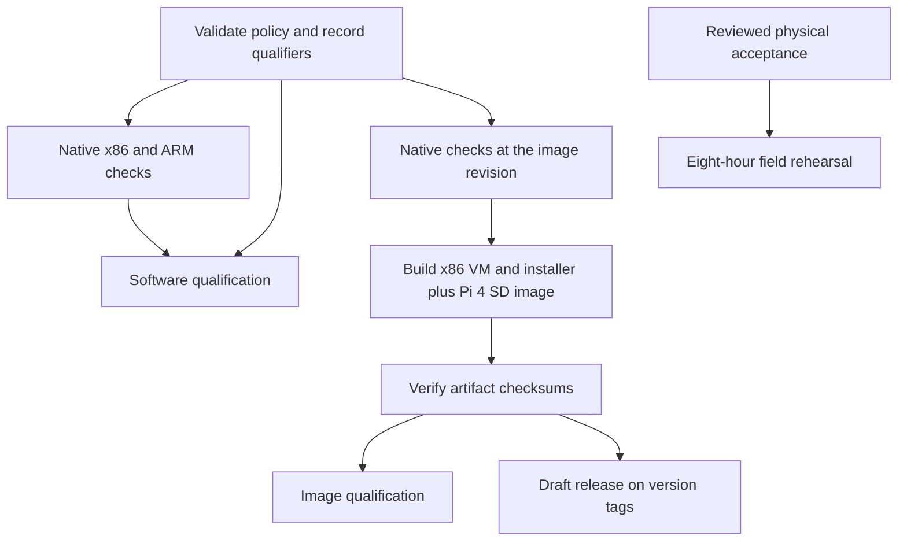

# CI qualification and dependency gates

Mish validates the exact PR merge commit, merge-group commit, main revision or
tag being built. Every PR and merge group runs both native Linux check jobs.
Change qualifiers describe affected components; they never skip validation.
Unknown paths or unavailable diffs retain full validation.



The machine-readable [policy](../.github/qualification.json) records workflow
job dependencies, milestone dependencies, component qualifiers and both required
merge contexts. The qualifier checks the policy against actual workflow YAML,
rejects cycles and unknown dependencies, records source and both lockfile hashes,
and uploads `qualification.json` and `qualification-graph.mmd`. Its job summary
also renders the dependency graph. Policy drift fails CI.

| Qualification | Evidence | Limit |
|---|---|---|
| Software validated | Both native checks: all-system evaluation, Rust tests/format/Clippy, schemas, CLI, module/workflow checks; x86 includes booted VM | Evaluation, realized checks and VM execution remain separately reported |
| Image built | Same-revision native checks, image realization and complete checksums | A built image does not qualify physical hardware |
| Hardware qualified | Reviewed target/image-specific commissioning and resilience record | Remains open until real mini-PC/radios and Pi 4 tests pass |
| Field qualified | Reviewed eight-hour rehearsal and measured RF/resource results | Remains open until pilot acceptance passes |

The native contexts retain their existing names. They run even if the qualifier
fails and explicitly fail on its result, so a skipped prerequisite cannot become
a green required context. Aggregate gates use `always()` and require every
declared prerequisite to return `success`; failure, cancellation, skipping,
missing results and unexpected results are rejected. Image workflows run native
validation before building, using signed cache outputs for identical derivations.
Release drafts depend on both qualification policy and successful image jobs.
Before draft creation, a separate integrity gate verifies both downloaded image
artifacts, complete checksums, architecture, source revision and committed
lockfile. It rejects corrupt, incomplete or mismatched artifacts.

M0 → M1 → M2, then M3 depends on both M1 and M2; M4 depends on M3; M5 depends
on M3 and M4. These dependencies follow the [roadmap](roadmap.md). CI produces
software evidence only. It does not approve a physical gate or publish a release.

Run the lightweight policy and regression checks locally with the bounded shell:

```sh
bash scripts/local-nix.sh --command python .github/scripts/qualification.py --verify-only
bash scripts/local-nix.sh --command python -m unittest discover -s tests -p 'test_*.py'
```

Full native, VM and image validation runs on GitHub runners to protect this
workstation from overlapping builds and evaluation memory growth.
