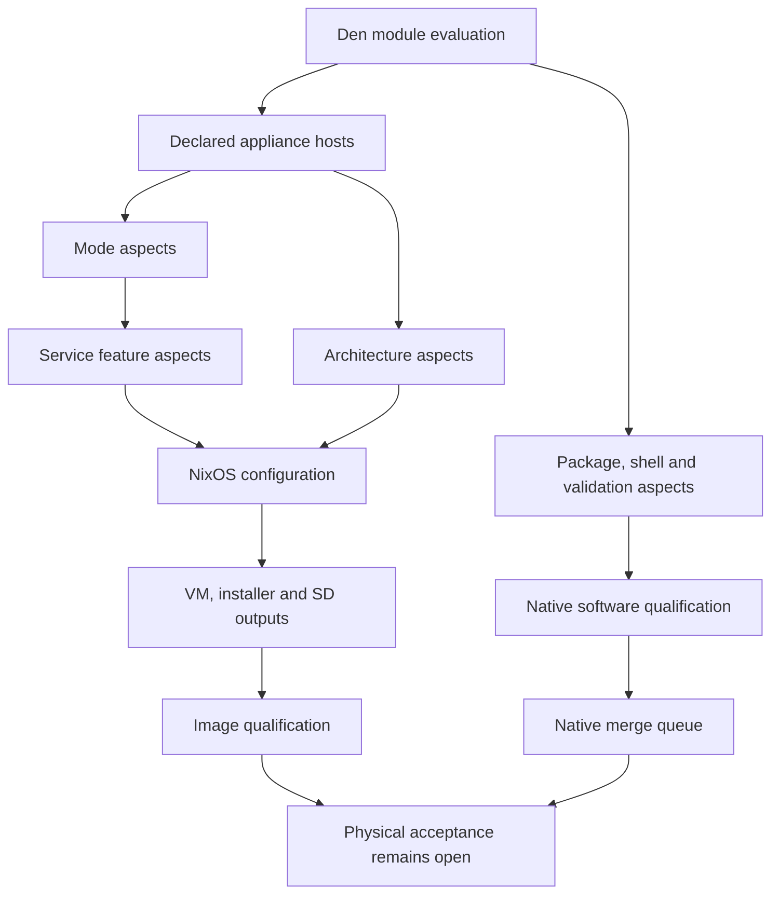

# Den composition for the Mish appliance

Mish uses Den to compose appliance modes, service features and hardware
architectures. This refactor concerns Nix composition; the Rust coordinator,
enrollment protocol, durable outbox and operator procedures retain their
existing interfaces. The [product status](product-status.md) separates software
progress from the outstanding physical acceptance gates.

## Reference and dependency

The implementation follows the local Den reference at
`~/projects/nix/den`, revision `65c9fd40e958109f5a352c1a93ae8254bf1ed29f`:
its minimal template, [flake migration guide](https://github.com/denful/den/blob/65c9fd40e958109f5a352c1a93ae8254bf1ed29f/docs/src/content/docs/guides/from-flake-to-den.mdx),
[output guide](https://github.com/denful/den/blob/65c9fd40e958109f5a352c1a93ae8254bf1ed29f/docs/src/content/docs/guides/flake-outputs.mdx)
and aspect/host definitions. The flake pins that upstream revision, so CI and
offline source preparation do not depend on the workstation checkout.

Use `nixpkgs.lib.evalModules` with Den's `flakeModule` and output declarations.
Explicit imports keep the composition visible without adding import-tree or
flake-parts. Den owns host generation through `den.hosts`; named aspects supply
NixOS configuration through their `nixos` class and compose through `includes`.
Selectable sub-aspects use `provides`.

The entry point is `nix/default.nix`. `nix/den/hosts.nix` selects aspects;
`nix/den/aspects.nix` defines the feature, mode and architecture namespaces.
`nix/den/outputs.nix` routes the existing output adapters in `nix/outputs.nix`
and `nix/checks.nix` through Den's per-system classes. `nix/context.nix` holds
the shared package overlay and supported-system list.

## Composition boundaries

| Layer | Responsibility |
|---|---|
| Features | Coordinator service, local HTTPS, operator tools and explicitly selected radio/simulation capabilities |
| Modes | Event coordinator, opt-in simulation and installation media |
| Architectures | x86 VM/installer, Pi 4 SD hardware profile and experimental Pi 5 NVMe/vendor builder |
| Hosts | Choose mode and architecture; retain stable configuration names |
| Build outputs | Preserve package, app, developer-shell, formatter, check and image targets |



The Pi 5 host retains the `nixos-raspberrypi` instantiation function and modules.
The supported package systems remain `x86_64-linux`, `aarch64-linux` and
`aarch64-darwin`; Darwin has development/package outputs and no appliance host.
Shared images carry no operator token or private channel key. Physical radio
configuration remains an explicit runtime commissioning action.

Reusable mode exports are `nixosModules.mish-coordinator`, `mish-simulation`
and `mish-meshtastic`. Architecture guards are `mish-x86_64` and
`mish-aarch64`. The existing `nixosModules.mish` service module remains
available for consumers selecting their own options. A mode's state-version
default does not override an existing host's explicit `system.stateVersion`.

For example, an existing NixOS host can select the USB coordinator mode:

```nix
{
  imports = [ inputs.mish.nixosModules.mish-meshtastic ];
  services.mish.radio.meshtastic.device = "/dev/serial/by-id/ACTUAL-RADIO-ID";
}
```

Supply the device's actual identifier, then commission and verify its channel
plan through the runtime CLI. The mode rejects the module's default placeholder
device. Simulation is an explicit alternative; combining it with USB fails
the radio selection assertion.

Existing `den.*` fields inside the reusable NixOS service module are legacy
capability metadata, evaluated in the NixOS module scope. The actual Den
framework runs in the outer flake scope. Preserve those metadata paths for
existing consumers and checks; they do not register or select framework
aspects.

## Acceptance and rollback

Preserve `nixosModules.mish`, the four existing `nixosConfigurations`,
`overlays.default`, all existing package/image names, CLI apps, developer shells,
formatter and check names. Shipped profiles retain their existing service
defaults, hostnames, state version, firmware settings and experimental status.
Composition checks must distinguish the event mode from opt-in simulation and
verify hardware/provider selection.

`den-composition` checks positive modes and specific rejection assertions for
the placeholder device, unstable device paths, simultaneous USB/simulation and
wrong architecture. It also checks that reusable modes preserve an explicit
older state version. The booted appliance VM imports `mish-simulation`, so its
HTTPS, messaging, acknowledgement and recovery scenario exercises actual Den
composition.

Run one bounded local evaluation at a time through `scripts/local-nix.sh`,
which invokes `nix develop`. Full all-system evaluation, native package/check
realization, x86 VM integration and image builds run on GitHub. Successful
software and image qualification establish the refactor's build behavior;
they do not close M2–M5 physical gates.

The pre-refactor source is `a4660ac`. Restoring that source restores the prior
flake; no application database or credential migration is introduced.
There is no deployed appliance to update. Production installation and immutable
release publication still require the recorded physical acceptance.
