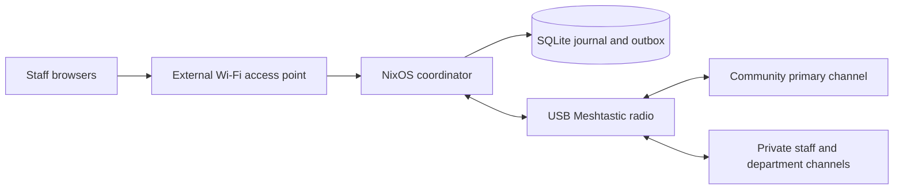

# Mish architecture and delivery gates

The first release has one authoritative local coordinator, SQLite persistence,
a bundled staff browser application and a USB Meshtastic adapter. A spare
appliance is activated manually. There is no automatic failover or database
replication. Internet, hosted accounts, public MQTT and external relays are
unnecessary during an event.

## Evidence inventory

The implementation is grounded in the existing repository. The
[design history](mish-design-history.md) records superseded concepts and
deferred integrations separately.

| Component | Repository evidence | Meaning and limit |
|---|---|---|
| NixOS composition | `modules/nixos/mish/`, `nix/default.nix`, `hosts/` | Reusable options, package/check and image definitions; evaluation does not establish bootability |
| Rust service and CLI | `apps/mish/src/`, `apps/mish/Cargo.lock` | Typed event domain, bounded coordinator, SQLite, HTTP/CLI and native serial transport; shared images need port-specific checks |
| Schemas and examples | `schemas/`, `examples/`, `catalog/` | Waypoint, GeoPack and catalog validation; not a complete event HTTP schema |
| Matrix | Rust `stub matrix` CLI, `matrix.nix` | Health stub; no Matrix message delivery |
| OpenZiti | Rust `stub openziti` CLI, `openziti.nix` | Health stub; no implemented enrollment or access enforcement |
| Reticulum/RNode | `radio.nix` | Daemon configuration; no event application messaging bridge |
| Original x86 image | `hosts/mish-mini-pc/` | QEMU VM, not a disk installer |
| Tests | `tests/`, flake `checks` | Separate test/evaluation/build/VM results must be reported explicitly |

Before this implementation, the plan recorded nine passing Python tests and
all-system evaluation. That historical baseline is not evidence that new
features, image builds or hardware tests passed. Record each verification run
with the source revision, command, environment and result.

## Architecture decisions

1. Use a Rust-native Axum service and Clap CLI with bundled static
   HTML/JavaScript, and SQLite as the authority
   for identities, messages, alerts, acknowledgements and a durable outbox.
   Package Cargo-locked application dependencies through Nix. A bounded Tokio
   coordinator owns the command boundary and a dedicated thread performs
   blocking database work. See [the Rust architecture decision](rust-architecture.md).
2. Use Caddy's local CA for HTTPS. Staff explicitly trust that CA during
   commissioning. Application authorization is independent of the deferred
   OpenZiti stub. Runtime credentials and radio channel keys are absent from
   shared images and the Nix store.
3. Treat web identity and radio channel membership as separate controls.
   Operators enroll staff and explicitly assign department membership. One
   community primary channel permits public radio participation; private
   secondary channels use independent 32-byte keys. A public join QR contains
   only community configuration. Department enrollment includes the community
   channel and the selected authorized department. Revoking a web credential
   does not remove a copied radio key; rotate affected keys and re-enroll radios.
4. Use stable `/dev/serial/by-id` radio paths, explicit serial permissions and
   reconnect backoff. Receive records do not automatically re-enter the outbox.
   Ambiguous transmission remains uncertain rather than claiming success.
   Snapshot restores quarantine pending sends: a backup cannot establish
   whether the original coordinator transmitted them after capture. Ordinary
   restarts retain their genuine pending queue.
   Configuration writes are a separate explicit operator provisioning action
   with readback verification; reconnect does not automatically reconfigure
   attached hardware.
5. Use Mish consistently for the CLI, Rust package, Nix modules, image
   targets and runtime paths. The full rename is authorized before the first
   deployment. Keep simulation clearly labelled and opt-in. Defer Matrix,
   OpenZiti, Nostr expansion, GeoPack expansion, Reticulum messaging and
   additional board qualification.
6. Use NixOS 26.05 and stateVersion 26.05 for the supported appliance targets.
   The state version change is authorized because these hosts have never been
   deployed. Do not infer this is safe for an existing appliance's future
   version upgrades.

## Milestone dependencies

The [channel-enrollment design](channel-enrollment.md) extends these milestones
with existing-channel import, generated event meshes, public/private QR scope
and verified USB provisioning. The implemented Rust feature has behavioral and
simulated USB evidence; physical app/USB/RF acceptance remains open. See
[product status](product-status.md) for the current revision evidence and
dependency-ordered next work, including [Den composition](den-architecture.md)
qualification.

| Milestone | Depends on | Deliverable | Acceptance gate |
|---|---|---|---|
| M0 baseline and CI | Existing repository audit | Traversal/malformed-input fixes, supported pin, initial checks | Existing behavior passes and regressions reject unsafe input |
| M1 x86 proof of concept | M0 | QEMU app, SQLite journal/outbox, deterministic radio simulator | Two staff exchange text, create/ack an alert and retain state across restart |
| M2 real mesh | M1 | USB receive/transmit/reconnect, community and private channels | Physical radios join intended channels and exchange text/ACKs without WAN; private traffic remains on its intended channel |
| M3 event kit | M1 and M2 acceptance | Installer, channel import/generation, scoped QR enrollment, verified provisioning, local HTTPS and recovery | Fresh installation provisions a radio with verified readback and reaches community/staff communication using the runbook |
| M4 ARM qualification | M3 | Same app/adapter on Pi 4 SD image | Pi 4 with 4 GB RAM passes physical commissioning and resilience checks |
| M5 field pilot | M3 and M4 | Rehearsal, RF/resource measurements, artifacts | Small-event checklist passes and remaining limitations are documented |

Delivered code may cover a later milestone before an earlier physical gate
passes. This does not close that milestone. Stable releases stay drafts until
physical acceptance evidence is recorded. The owner waived that publication
gate for non-stable prereleases; software and artifact-integrity gates remain
required. The [decision log](decisions/DECISION-LOG.md) records the waiver.

M0 and M1 software gates have passed. M2 and M3 have implemented software;
M4 has realized ARM artifacts. M2–M5 physical gates remain open, and Mish has
never been deployed. The Den refactor's native software, VM and image gates
passed for `8b90573`; see [product status](product-status.md) for revision-specific
evidence. Required checks still run on each candidate and release revision.

## Alert semantics

Track local durable persistence, queue state, radio submission, transport
confirmation, transmission uncertainty and human acknowledgement independently.
A Meshtastic broadcast acknowledgement may report rebroadcast by another node;
it does not establish staff receipt or reading. An urgent alert has a short ID,
an accountable responder, expiration and explicit acknowledgement.

Authenticated browser acknowledgements identify enrolled staff. Stock radio
clients can reply `ACK <ID>`; store the node/channel provenance and present it as
a radio-reported acknowledgement. Radio channel membership is not an
authenticated browser identity and neither mechanism means every recipient
responded. Expired alerts cannot gain fresh acknowledgements or be transmitted
as active alerts. Duplicate packets must not create duplicate records or
repeated acknowledgements.

Shared Meshtastic channel membership permits transmission. The community
channel is intentionally a participatory radio surface. The former read-only
attendee announcement feed is superseded as the public product model. Community
participation uses the Meshtastic app; the public browser provides enrollment
only. Existing announcement routes do not substitute for channel enrollment.
Radio access does not create
an authenticated staff web identity. Dedicated emergency dispatch procedures
are outside this first release.

## Channel configuration and enrollment

Use one community primary and private secondary channels, with eight total
radio slots and names limited to 11 UTF-8 bytes. An event label may be longer:
Astral Valley can use `AstralMesh` as its radio channel name. Generate full
256-bit community keys and independent 32-byte keys for every private channel.
Store keys in protected runtime state and enrollment artifacts, never shared
images. Only the community key appears in public enrollment; private channel
keys require authorized exports.

Importing a single PRIMARY community URI preserves LoRa settings and opaque unknown
configuration fields. Preview the intended slot layout before an explicit USB
write, then verify hardware readback before reporting successful provisioning.
Generate QR enrollment locally in the Rust runtime. A public QR includes only
community configuration; a department QR includes community plus the selected
authorized department. Additional staff channels require explicit membership.
Copied private keys require radio reconfiguration or key rotation for removal.
Multi-channel community imports are rejected to keep private channel settings
out of the public enrollment projection.
See [channel-enrollment.md](channel-enrollment.md) for the detailed gate checklist.

## Operating targets

The pilot is 10–30 staff, up to 20 radios, one active coordinator and optional
manual spares. Default retention is seven days, with operator export and an
explicit end-of-event wipe. Engineering targets are under 1 GB application RAM,
30-minute commissioning and no loss of messages whose durable acceptance was
confirmed. RF coverage and latency are measured pilot results, not promises.
A Pi 4 with 2 GB RAM remains experimental until measured.

## Future architecture options

The supplied Claude Overkill comparison is retained for future architecture
reviews with `--max --advanced --current`. These are optional spikes after M5;
time estimates are planning judgments, not production delivery estimates.
Reverify upstream maintenance and references before choosing an implementation.

| Approach | Complexity | First commit estimate | Operations / specialist burden | Trigger for adoption |
|---|---|---|---|---|
| CRDT replication | 8/10 | 1–2 weeks | High / high | Multiple coordinators must accept authorized changes while disconnected |
| Delay-tolerant networking | 8/10 | 2–4 weeks | High / high | Venue zones reconnect intermittently and require cross-transport forwarding |
| Formally specified alert protocol | 7/10 | 1–2 weeks | Low runtime / high verification | Retries, replication and takeover complicate alert ownership |

CRDTs add convergence and causal-ordering concerns to authorization, expiration
and cancellation. Evaluate [Automerge](https://automerge.org/) over IP first;
radio synchronization needs a separate airtime budget. Persistent bundles add
routing, expiration and storage responsibilities; study
[Bundle Protocol v7](https://www.rfc-editor.org/rfc/rfc9171.html) and
[NASA ION](https://github.com/nasa-jpl/ION-DTN). TLA+ can check duplicate,
restart, expiry and takeover invariants before implementing distribution; use
[command-line TLC tooling](https://github.com/tlaplus/tlaplus) and
[Lamport's course](https://lamport.azurewebsites.net/tla/tutorial/contents.html).
Measured failures, rather than architectural ambition, determine which spike
becomes justified.
