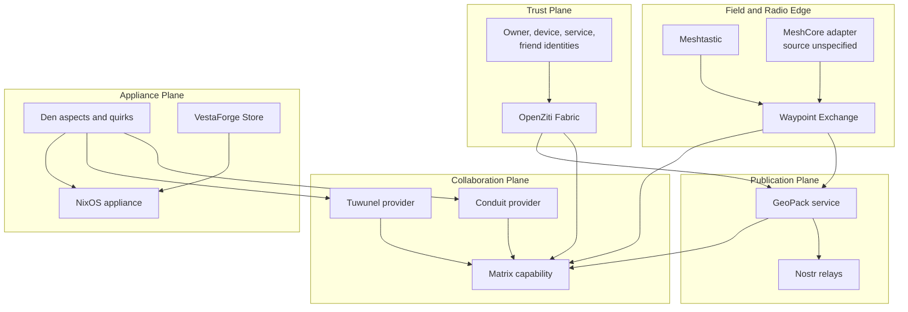
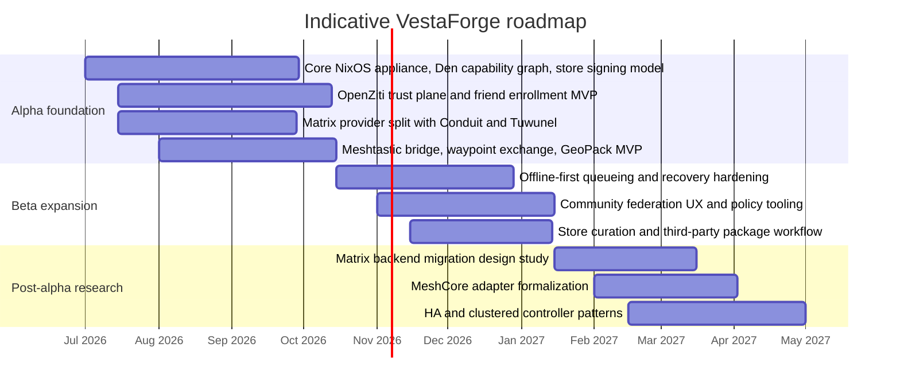

# VestaForge

## Executive Summary

VestaForge is best understood not as a mesh-radio project with add-ons, but as a **sovereign communications and trust appliance** that unifies identity-centric secure access, offline-capable coordination, federated messaging, public signed publication, and field-radio integration into a NixOS-based deployable system. This whitepaper supersedes the earlier Meshrebellion alpha draft, preserving its pivot toward a NixOS appliance, a Den-based composition model, and an OpenZiti-first trust architecture while removing or deferring components that no longer fit the alpha scope. fileciteturn0file0 citeturn7view0turn19view3

The central design decision is to treat **OpenZiti as the trust and service-access fabric**, **Matrix as the federated collaboration layer**, **Nostr as the signed public publication layer**, **Meshtastic as the release-gated radio adapter**, **Reticulum/RNode and MeshCore as experimental field-radio adapters**, **GeoPack and waypoint exchange as portable location-aware content formats**, and **NixOS as the appliance substrate**. OpenZiti’s documented model of identities, enrollments, service policies, posture checks, mTLS-secured control/link/edge connections, and SDK-level end-to-end encryption makes it a strong fit for VestaForge’s owner-controlled, friend-scoped, least-privilege network design. Matrix contributes an open federation model across homeservers, while Nostr provides a lightweight event and relay protocol well suited to signed, portable metadata and public announcements. Meshtastic provides the off-grid LoRa mesh layer that motivates the project’s field and disaster-response scenarios, while Reticulum/RNode provides an opt-in path for cryptographic, heterogeneous, low-bandwidth network transport. citeturn7view0turn8view0turn8view1turn4view1turn13view3turn13view5turn12view0

For the 0.1 alpha, VestaForge will release-gate two first-party Matrix backend targets selected at installation or profile time: **Conduit** for Raspberry Pi 4-class SBC deployments, and **Tuwunel** for Mini-PC deployments. The `home-server` profile remains represented in the catalog and option model, but it is not a release-gated 0.1 target. There is **no automatic backend switching**, **no shared database assumption**, and **no migration tooling in the alpha**. This is not merely a product limitation; it is a deliberate safety boundary. Tuwunel’s own upstream documentation warns against switching casually among Conduit-family forks because database corruption can result, even while describing separate future migration work. VestaForge should therefore treat backend changes as a future research problem, not an alpha operational promise. citeturn15view0turn16view1turn16view6

The deployment model is profile-driven. Raspberry Pi 4-class AArch64 hardware remains the most defensible low-power target in the current NixOS ecosystem, while Raspberry Pi 5 support still depends on bespoke steps and community-maintained workarounds rather than an out-of-the-box path. That makes Pi 4 the recommended reference for the alpha SBC tier, while the x86_64 Mini-PC profile carries the heavier federation and storage responsibilities for 0.1. The home-server profile should remain a post-alpha or non-gated expansion target until its storage, availability, and support boundaries are specified. Nix’s flakes, signed substituters, and trusted-public-keys mechanism make a signed project store operationally coherent, while NixOS also supports LUKS unlocking with FIDO2 tokens enrolled through `systemd-cryptenroll`, which fits the project’s secure-appliance posture. citeturn18view4turn18view5turn19view3turn18view2turn18view3turn18view6turn18view7

The recommended branding direction, **VestaForge**, is stronger than the older Meshrebellion name because it emphasizes a trusted, owner-operated digital hearth deliberately built and maintained by its operator, rather than reducing the platform to radio mesh networking alone. In quick web searches performed for this paper, no obvious software project collision surfaced for “VestaForge,” but this was not an exhaustive trademark, namespace, or domain-availability check. Candidate GitHub and domain names are therefore recommended below as proposals, not verified reservations.

## Problem Statement and Design Goals

### Problem Statement

Modern community communications are fragmented across centralized SaaS platforms, consumer chat systems, opaque device ecosystems, and brittle network assumptions. Homelab users want self-hosted services without enterprise complexity. Community-network operators need portable, trust-minimized collaboration that survives unreliable upstream connectivity. Cyberdeck and off-grid users need field-capable communications that do not collapse when the internet disappears. Disaster-preparedness groups need a deployable stack that can continue operating locally, synchronize opportunistically, and expose narrowly scoped services only to explicitly trusted parties. Meshtastic addresses part of this problem at the radio edge, but not the whole system problem of identity, access control, data publication, packaging, federation, and appliance lifecycle. citeturn12view0turn7view0turn4view1turn13view5

The earlier project draft correctly identified the need to pivot away from a narrow “mesh app” framing toward a broader sovereign appliance model. It also identified that the alpha needed stronger composition, reproducibility, and service-boundary discipline than an ad hoc stack would provide. This whitepaper carries that architecture forward and tightens it into an installable, supportable, client-facing platform specification. fileciteturn0file0

### Design Goals

VestaForge should be designed around seven primary goals.

First, it should provide **owner-controlled trust boundaries**. OpenZiti identities, service policies, and authentication policies are better aligned with this goal than legacy perimeter networking because they authorize access to named services for named identities rather than to broad IP space. citeturn7view0turn8view4turn9view3

Second, it should support **offline-first local operation**. Local messaging, waypoint access, configuration, and store state should continue to function without continuous internet connectivity. Synchronization to Matrix federation, Nostr relays, or external peers should happen opportunistically and idempotently. This is a VestaForge design requirement; exact queue semantics and conflict-resolution policy remain to be specified.

Third, it should support **profile-driven deployment** across lightweight SBCs, Mini-PCs, and home servers. NixOS’s module-based composition, reproducible packaging model, and flake workflow are well suited to that operational shape, even while the `nix flake` interface remains officially marked experimental. citeturn17view0turn19view3turn18view1

Fourth, it should provide **federated human collaboration** through Matrix. Matrix is explicitly designed as a set of open APIs for decentralized communication over a federation of homeservers, with room state replicated across participating homeservers and synchronized through the server-server API. citeturn4view1

Fifth, it should provide **signed public publication** through Nostr. Nostr’s event model, keypair-based signing, relay transport over WebSockets, and support for regular, replaceable, and ephemeral event kinds make it a strong fit for publishing signed GeoPack manifests, release announcements, public waypoints, and metadata catalogs. citeturn13view3turn13view5

Sixth, it should integrate **radio edge networks** rather than replace them. Meshtastic’s documented use of inexpensive LoRa radios, rebroadcast behavior, encrypted long-range off-grid communication, and optional GPS-based position features make it the canonical first radio adapter for the alpha. Reticulum/RNode is now modeled as an experimental provider for operators who want a cryptographic network stack over LoRa or mixed carriers, but it is not release-gated until packaging, licensing, and operational defaults are hardened. MeshCore remains in conceptual scope, but its official source materials were unspecified in the source set for this paper and are therefore treated as an integration target rather than a formally cited dependency. citeturn12view0turn12view2

Seventh, it should remain **operator-actionable**. Engineering teams need a composition model with explicit capabilities and provider aspects; product teams need deployment tiers, support boundaries, and roadmap sequencing that does not imply unsupported migrations or hidden compatibility promises.

## System Architecture

### Architectural Overview

VestaForge should be organized into five logical planes.

The **trust plane** is OpenZiti. It owns identities, enrollments, service authorization, posture-aware access decisions, and encrypted service connectivity. OpenZiti defines identities for people, devices, and services, authenticates them through configured authenticators and policies, grants `dial` or `bind` access via service policies, and secures its control, link, and edge paths with mTLS while providing SDK-level end-to-end encrypted service traffic. citeturn7view0turn8view1turn8view0turn9view2turn9view3

The **collaboration plane** is Matrix. Matrix clients synchronize with their homeserver; homeservers replicate room history and event graphs across federation using the server-server API. In VestaForge, this is the layer for persistent rooms, community coordination, friend-group messaging, and structured collaboration that benefits from eventual consistency and federation. citeturn4view1

The **publication plane** is Nostr. In VestaForge, Nostr is not the administrative root of trust. Instead, it is the mechanism for signed public publication of things such as GeoPack indexes, public waypoint catalogs, event announcements, and lightweight public metadata that should remain portable across relays. citeturn13view3turn13view5

The **edge plane** is the radio and field layer. Meshtastic is the alpha reference implementation here, while Reticulum/RNode is available as an experimental alternate provider. Device position data, radio-originated messages, and field-generated waypoints enter VestaForge through this layer and are normalized upstream into waypoint and GeoPack services. citeturn12view0turn12view2

The **appliance plane** is NixOS plus Den. NixOS supplies system composition, package deployment, secure boot-time storage unlock, and image generation. Den supplies the project’s internal capability and aspect model, including the shared `matrix` capability with backend-specific providers that must emit the same Den quirk shape, such as `den.quirks.meshServices.matrix`. The present paper treats Den’s internal schema as a project-owned abstraction rather than a standards dependency. citeturn17view0turn19view3turn18view2turn18view6turn18view7



### Component Responsibilities

The following responsibility split is the recommended baseline for engineering teams.

| Component | Primary responsibility | Alpha status | Notes |
|---|---|---|---|
| OpenZiti trust fabric | Identity, enrollment, `dial`/`bind` service access, posture-aware authorization, encrypted service paths | In scope | Authoritative trust and service-access layer |
| Den capability model | Internal composition model for capabilities, provider aspects, quirks, and profile assembly | In scope | Project-owned abstraction |
| Matrix capability | Federated rooms, persistent messaging, collaboration state | In scope | Backed by Conduit or Tuwunel |
| Conduit provider | Lightweight Matrix homeserver backend | In scope | Preferred for SBC/RPi tier; upstream explicitly targets easy Raspberry Pi deployment citeturn15view0 |
| Tuwunel provider | Featureful Matrix homeserver backend | In scope | Release-gated default for Mini-PC; modeled default for the non-gated home-server profile; upstream publishes Nix package and NixOS module references citeturn16view1turn16view2 |
| GeoPack service | Packaging, signing, storing, and syncing waypoint-rich bundles | In scope | Project-defined format; final schema unspecified |
| Nostr publishing | Signed public manifests, release metadata, public catalogs | In scope | Not the admin identity root |
| Meshtastic adapter | Radio ingress/egress and field message transport | In scope | Alpha release-gated radio edge stack citeturn12view0turn12view2 |
| Reticulum/RNode adapter | Cryptographic low-bandwidth network transport over RNode LoRa | Experimental | Implemented as opt-in provider; not release-gated |
| MeshCore adapter | Alternative radio stack integration | Deferred detail | Official source unspecified in this paper |
| Waypoint exchange | Normalize, dedupe, enrich, and route waypoint objects between planes | In scope | Project-defined service |
| VestaForge Store | Signed package and profile catalog distribution with policy gating | In scope | Backend implementation unspecified; trust model should follow signed Nix substituters |
| NixOS appliance | Base OS, boot, storage, updates, image generation, module composition | In scope | Flake-driven, profile-driven appliance substrate |

### Data Flows

The most important VestaForge data flow starts at the edge. A Meshtastic node or paired client emits a position update or field message. The VestaForge waypoint exchange normalizes the object, preserves provenance, and decides whether the object becomes a local-only update, a friend-scoped GeoPack delta, a Matrix room artifact, or a public Nostr-announced pack. Meshtastic’s position configuration and GPS-driven broadcast options make this kind of edge-derived location data operationally realistic, even though VestaForge’s higher-level waypoint schema is project-defined rather than inherited directly from Meshtastic. citeturn12view2

A second key flow is public publication. GeoPack manifests should be signed and published to Nostr as events so that external consumers can subscribe to updates over standard relay connections. Nostr’s protocol model is explicitly built around signed events, WebSocket relay transport, and event queries through `REQ` subscriptions. Replaceable and regular event conventions are especially useful here: a manifest index can be modeled as replaceable metadata, while announcements and versioned release notes can be regular events. citeturn13view3turn13view5

The third key flow is friend-scoped collaboration. For friend networks and small communities, the system should prefer OpenZiti-protected services and Matrix rooms over public publication. OpenZiti identities and policies determine who can reach the service endpoints; Matrix provides the higher-level state and messaging history. This lets VestaForge separate “who is allowed to reach the service” from “what collaborative objects users exchange once connected.” citeturn7view0turn9view2turn4view1

A fourth flow is lifecycle management. The project store publishes signed package or profile catalogs; the appliance consumes only trusted substituters and trusted public keys; Den then assembles the selected profile and capability providers into the final appliance configuration. Nix’s `trusted-public-keys` and substituter trust model are the right primitives for this, though the exact catalog backend remains unspecified in this version. citeturn18view2turn18view3

### Den Capability Model

The Matrix portion of the architecture should be represented through a **shared Den capability** with provider-specific aspects rather than through backend-specific product logic scattered across the tree. Both providers must emit the same quirk contract so that dashboards, policies, backup jobs, and store logic can rely on a stable shape regardless of backend.

```nix
den.aspects.matrix-conduit = {
  nixos.meshServices.matrix = {
    provider = "conduit";
    domain = "example.org";
  };

  den.quirks.meshServices.matrix = {
    backend = "conduit";
    serviceName = "matrix";
    domain = "example.org";
  };
};

den.aspects.matrix-tuwunel = {
  nixos.meshServices.matrix = {
    provider = "tuwunel";
    domain = "example.org";
  };

  den.quirks.meshServices.matrix = {
    backend = "tuwunel";
    serviceName = "matrix";
    domain = "example.org";
  };
};
```

This design is important because it prevents accidental backend coupling. To the rest of the appliance, there is a `matrix` capability. Only the provider aspect knows whether it is rendering Conduit or Tuwunel.

## Deployment Profiles and Operations

### Deployment Profiles

The alpha profile model should remain intentionally narrow.

| Profile | Primary target | Assumed architecture | Matrix backend policy | Typical role |
|---|---|---|---|---|
| SBC / Raspberry Pi | Raspberry Pi 4-class low-power nodes | AArch64 first-class; exact non-Pi SBC list unspecified | Conduit only | Radio bridge, local waypoint cache, friend gateway, low-power community node |
| Mini-PC | NUC / small x86_64 or comparable node | x86_64 assumed by default; exact ARM Mini-PC support unspecified | Tuwunel default, Conduit optional | Main household or field-base node, richer federation, local services |
| Home-server | Rack or stationary always-on system | x86_64 assumed unless client later specifies otherwise | Tuwunel | Modeled but not release-gated in 0.1; future primary trust-domain controller, larger storage, broader community services |

This profile split is strongly aligned with upstream characteristics. Conduit explicitly describes itself as an efficient Rust Matrix homeserver intended to be easy to set up and suitable for mini-computers like the Raspberry Pi. Tuwunel presents itself as a featureful, scalable, enterprise-ready Matrix homeserver in Rust and explicitly advertises a Nix package and a NixOS module entry. citeturn15view0turn16view1turn16view2

For low-power hardware, Raspberry Pi 4 remains the strongest documented NixOS reference platform in this class. The official NixOS wiki describes the Pi 4 family as AArch64-supported, notes that the generic SD image works, and points users to `nixos-hardware` guidance for board quirks. By contrast, the Pi 5 page openly states that NixOS does not run out of the box and currently relies on tweaks maintained across multiple repositories. For an alpha appliance, that difference matters. VestaForge should therefore treat Raspberry Pi 4 as the reference SBC and Pi 5 as a later, non-reference target until support stabilizes. citeturn18view4turn18view5

### Matrix Backend Policy

The Matrix choice in the alpha is a **deployment-time decision**, not an in-place runtime toggle.

| Question | SBC / RPi | Mini-PC | Home-server |
|---|---|---|---|
| Default backend | Conduit | Tuwunel | Tuwunel |
| Optional alternate | None in alpha policy | Conduit | None in alpha policy |
| First-party simultaneous install for same domain | Blocked | Blocked | Blocked |
| Automatic switching | No | No | No |
| Shared DB assumption | No | No | No |
| Migration tooling in alpha | None | None | None |

This policy is consistent with two facts. First, Conduit’s own positioning emphasizes lightweight deployment, including Raspberry Pi-class hosts. Second, Tuwunel upstream explicitly warns that casually switching between different Conduit-family forks can permanently corrupt the database, even while it separately documents future migration work for specific upstreams. VestaForge’s alpha policy should therefore be stricter than the most optimistic upstream migration roadmap: backend changes are planned research, not operator promises. citeturn15view0turn16view6

> **Alpha risk callout**  
> Attempting to treat Conduit and Tuwunel as hot-swappable backends would create hidden compatibility, support, and data-integrity risk.  
> **Mitigation:** select the provider aspect at install or profile time, require a fresh deployment when the backend changes, and make the project store reject any catalog action that would install both homeservers for the same Matrix identity or domain.

### Operational Considerations

The first operational principle is **profile determinism**. A VestaForge image should declare its profile and provider choices explicitly in its flake and Den graph. Because `nix flake` is officially still marked experimental, engineering teams should keep critical deployment logic in normal NixOS modules and use flakes primarily as the locked distribution envelope and artifact entrypoint. citeturn19view3turn18view1

The second operational principle is **signed distribution**. The renamed project store, referred to here as the **VestaForge Store**, should publish signed package and profile catalogs and should integrate with Nix’s substituter trust model. Nix only accepts copied store objects from another store when the relevant trust conditions are met, including trusted substituters or trusted users and matching trusted public keys. That is the right foundation for an appliance ecosystem that wants curated third-party functionality without abandoning reproducibility and signature verification. citeturn18view2turn18view3

The third operational principle is **secure local state**. The appliance should keep mutable service state and credentials on encrypted persistent storage rather than assuming a generic mutable root. NixOS supports LUKS unlocking with FIDO2 tokens and explicitly documents token enrollment through `systemd-cryptenroll`. Exact partitioning, persistence layout, and snapshot strategy remain unspecified in this paper and should be finalized in implementation design. citeturn18view6turn18view7

The fourth operational principle is **graceful degradation**. If internet connectivity fails, the node should continue serving local admin functions, local waypoint lookup, radio bridge workflows, and local Matrix service for directly connected clients. Federation and public publication should resume when connectivity returns.

## Security, Alpha Limitations, and Governance

### Security Model

VestaForge’s security model should begin with the **owner-local trust domain**. Each appliance or appliance cluster belongs to an owner-controlled OpenZiti network that creates and enrolls identities for the operator, the node itself, internal services, and optionally friends or guests. OpenZiti defines identities, authenticators, enrollments, authentication policies, service policies, edge-router policies, posture checks, and authentication queries as first-class security entities. That model maps directly to VestaForge’s need for explicit trust relationships rather than broad network reachability. citeturn7view0

At the transport layer, OpenZiti gives VestaForge a layered security story. Control, link, and edge connections are documented as mTLS-protected, while application service traffic can be end-to-end encrypted so that even compromised routers do not reveal raw application data. This is especially well aligned with friend-scoped services and internal service decomposition because the same fabric can secure both internal and external service access with the same identity model. citeturn8view1turn8view0

At the authentication layer, OpenZiti’s authentication policies can require a secondary TOTP factor. For VestaForge, this should be mandatory for privileged administrative identities and recommended for operators who expose management functions beyond a physically local environment. citeturn9view3turn9view4

At the collaboration layer, Matrix contributes federation and event integrity, but VestaForge should still treat Matrix content as application data rather than as an authorization source. Matrix homeservers store user account information and share room history over federation; the OpenZiti trust plane remains the correct place to decide whether a given user, device, or service can even reach VestaForge-managed services. citeturn4view1

At the publication layer, Nostr contributes cryptographically signed events, but not strong service authorization semantics. That makes it ideal for public catalogs and announcements, not for privileged administrative access. VestaForge should therefore treat Nostr as publish-plane infrastructure and OpenZiti as trust-plane infrastructure. citeturn13view3turn13view5

### Alpha Limitations

The following alpha limitations should be stated plainly and repeatedly in product and engineering materials.

There is **no migration path between Conduit and Tuwunel in the alpha**. Upstream Tuwunel documentation indicates that Conduit migration is planned, but it also warns strongly against unsafe switching across Conduit-family forks. VestaForge’s alpha should therefore provide no wizard, no compatibility guarantee, and no shared-database assumption for backend swaps. citeturn16view6

There is **no dual-homeserver install** for the same Matrix identity or domain. The VestaForge Store should block this combination at catalog evaluation time.

There is **no generic cluster specification** in this version. Exact high-availability controller patterns, storage replication, and disaster-recovery posture are intentionally out of scope for the alpha unless separately mandated by the client.

There is **no formal MeshCore source profile** in this paper. MeshCore remains an integration target, but the current document does not rely on a cited authoritative source set for its behavior.

There is **no commitment to specific Mini-PC or Mac mini hardware** beyond the profile class. When hardware specificity matters, the current requirement is explicitly unspecified.

> **Alpha risk callout**  
> Profile creep is a near-term delivery risk. Supporting too many hardware permutations, storage layouts, and backend combinations will slow the alpha and dilute test coverage.  
> **Mitigation:** certify one SBC reference target and one Mini-PC reference target for 0.1 before adding a home-server release target or expanding hardware scope.

> **Alpha risk callout**  
> Public publishing can leak operational metadata if private and public objects are not separated cleanly.  
> **Mitigation:** treat Nostr as a public publish plane only; keep friend-scoped synchronization on OpenZiti-protected services and private Matrix spaces.

### Governance and Community Model

VestaForge should adopt a governance model that is lightweight enough for early execution but explicit enough for a high-profile client relationship.

The recommended structure is a **maintainer council** with three standing authorities: an architecture authority for cross-component interfaces and profile rules, a security and release authority for signing policy and trust boundaries, and capability maintainers for each major service family such as Matrix, GeoPack, radio integration, and the store. All interface changes that affect Den quirks, provider contracts, or cross-profile compatibility should require written design notes and versioned change records.

The contribution model should be **upstream-first where possible, platform-stable where necessary**. VestaForge should not unnecessarily fork Conduit, Tuwunel, Matrix libraries, NixOS modules, or Meshtastic components unless the client requires platform-specific changes that cannot be landed upstream on an acceptable timeline.

The release model should be **signed and policy-gated**. The store catalog, profile bundles, and release artifacts should be signed by project keys, with signer rotation and revocation treated as first-class operational events.

## Governance, Branding, and Naming Conventions

### Why VestaForge

“Meshrebellion” described an early phase of the project, but it no longer describes the assembled architecture. The current system is not merely a rebellious mesh network. It is a deliberately constructed sovereign appliance for trusted communications, publication, and coordination across homes, communities, and field deployments. The new name should therefore signal **home, continuity, resilience, and intentional construction**.

“VestaForge” does that well. “Vesta” evokes the idea of a trusted hearth and a durable center of communal life. “Forge” communicates active construction, tool-making, and owned infrastructure. Together, the name suggests a place where operators build and maintain their own trusted network rather than rent one from a third party. That framing is more aligned with OpenZiti trust fabrics, NixOS appliances, Matrix federation, signed GeoPacks, and self-hosted service catalogs than the older mesh-first branding.

In quick searches performed for this whitepaper, no obvious present-day software collision surfaced for “VestaForge.” That said, this was not an exhaustive trademark, corporate registry, package namespace, or domain-registration check, and client counsel should still perform a full clearance review before launch.

### Suggested GitHub and Domain Conventions

The most coherent repository and organization layout would be:

| Purpose | Suggested name |
|---|---|
| GitHub organization | `vestaforge` |
| Main monorepo | `vestaforge` |
| Documentation | `vestaforge-docs` |
| Website | `vestaforge-site` |
| GeoPack tooling | `vestaforge-geopack` |
| Radio adapters | `vestaforge-radio` |
| Den aspects and modules | `vestaforge-den` |
| Store server or catalog | `vestaforge-store` |
| Reference appliance images | `vestaforge-images` |

Candidate domains to validate include `vestaforge.org`, `vestaforge.net`, `getvestaforge.org`, and `vestaforge.io`. These are suggestions only; this paper does not claim verified availability.

Recommended repository conventions are straightforward. User-facing repos should begin with `vestaforge-`. Internal libraries should live under `lib/` within the main monorepo unless there is a clear reason to split them. Capability providers should mirror Den names where possible. For example, `matrix-conduit` and `matrix-tuwunel` aspect names should align with documentation, CI job naming, and store catalog identifiers.

## Roadmap and Appendix

### Indicative Roadmap

The roadmap below is intentionally conservative. It assumes the client wants a credible alpha rather than a wide but brittle first release.



### Appendix of Obsolete, Removed, or Deferred Components

The following items should be treated as obsolete, removed, or deferred relative to the earlier draft and conversations.

| Item | New status | Rationale |
|---|---|---|
| Headscale and DERP-centric control plane | Removed from current architecture | The project pivoted to OpenZiti-first trust fabrics. OpenZiti’s identity, policy, posture, and encrypted service model is a better match for named-service access than network-wide overlay assumptions. fileciteturn0file0 citeturn7view0turn8view1turn8view0 |
| “Mesh-first” product framing | Removed | The platform now encompasses trust fabrics, publication, federation, store policy, and appliance lifecycle in addition to radio mesh. fileciteturn0file0 |
| Automatic Matrix backend switching | Explicitly out of scope for alpha | Unsafe to imply compatibility where project policy offers none; upstream database-switching warnings reinforce this boundary. citeturn16view6 |
| Shared Conduit/Tuwunel database assumption | Rejected | Alpha must not assume interchangeable storage or safe in-place backend swaps. citeturn16view6 |
| Migration tooling between Conduit and Tuwunel | Deferred | Upstream Tuwunel documents some migration goals, but the client’s alpha constraints explicitly defer this capability. citeturn16view6 |
| Rebellion Store name | Renamed | In this paper it becomes the VestaForge Store or project store; same conceptual role, updated branding. |
| Guix as the alpha appliance base | Deferred | Earlier analysis favored NixOS because of stronger module, flake, image, and ARM deployment ergonomics. fileciteturn0file0 citeturn17view0turn19view3 |
| Raspberry Pi 5 as first-wave reference target | Deferred | Current official guidance still describes Pi 5 as requiring bespoke steps rather than working out of the box. citeturn18view5 |
| MeshCore implementation specifics | Unspecified | MeshCore remains in scope conceptually, but official source materials were unspecified for citation in this paper. |

### Final Engineering Directives

The most important actionable directives from this whitepaper are straightforward.

The alpha should ship as a **NixOS appliance with a Den-composed capability graph**. Matrix should expose a single shared capability with provider-specific aspects and a common quirk contract. OpenZiti should own trust, access, and friend-scoped service exposure. Matrix should own collaboration. Nostr should own signed public publication. Meshtastic should remain the first release-gated radio edge adapter, with Reticulum/RNode available experimentally for operators testing cryptographic LoRa transport. GeoPack and waypoint exchange should be treated as VestaForge-native objects and services. The 0.1 release-gated targets should be Raspberry Pi 4-class SBCs with Conduit and x86_64 Mini-PCs with Tuwunel; home-server should remain modeled but non-gated until its operational boundary is specified. The project store should enforce signature trust and prevent unsupported multi-backend states for the same Matrix identity or domain. Where exact implementation details remain unspecified, they should remain variables in the implementation plan rather than becoming accidental promises in product messaging.
